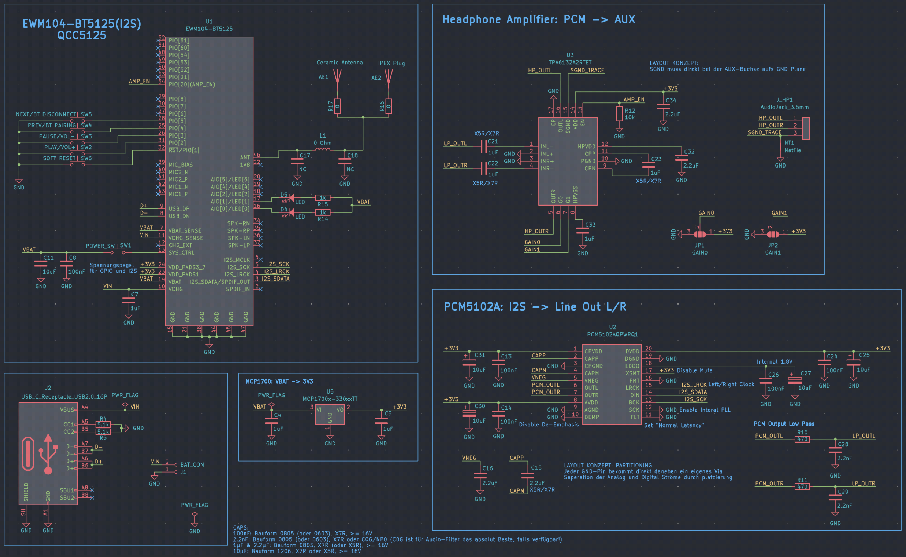
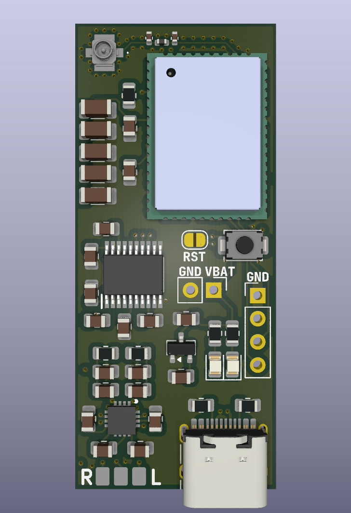

# btaudio — Bluetooth 5.1 upgrade board for wired headphones

A wireless upgrade module for wired headphones. Instead of an all-in-one chip, it uses three dedicated stages,
so the radio, the conversion and the amplification stay cleanly separated.

## Architecture

```
EWM104-BT5125 (QCC5125, BT 5.1)  →[I2S]→  PCM5102A (DAC)  →[analog]→  TPA6132A2 (amp)  →  headphones
          receive                           convert                       amplify
```

**Stage 1 — Receive:** the EBYTE EWM104-BT5125(I2S) module with a Qualcomm QCC5125 receives the audio (aptX HD, AAC, SBC)
and passes it on digitally over I2S.

**Stage 2 — Convert:** the PCM5102A turns the I2S stream into an analog line signal. It runs in PLL mode, without MCLK.

**Stage 3 — Amplify:** the TPA6132A2 drives the headphones directly (DirectPath / capless), with no electrolytic
caps in the signal path.

## Board (rev 1)

- 4 layers, 51 × 22 mm
- USB-C for charging (through the module's built-in charger); LiPo on a pin header
- IPEX (U.FL) connector for an external antenna
- Solder pads for the headphone cable; pin header for external buttons
- Gain set with solder jumpers (−6 / 0 / 3 / 6 dB)

Full design: [PLAN.md](PLAN.md) · Project notes (German): [DOC.md](DOC.md)

## Status

The board has been manufactured, assembled and verified. However, the delivered module ("Version: I") outputs its
audio on the analog SPK pins instead of I2S, so it behaves like the DAC firmware. This is being resolved with EBYTE.

- Bring-up log: [btaudio/BRINGUP_TESTPLAN.md](btaudio/BRINGUP_TESTPLAN.md)
- Report to EBYTE: [btaudio/EBYTE_REPORT.md](btaudio/EBYTE_REPORT.md)

## Schematic



## PCB (3D view)



## Hardware

- **BT module:** EBYTE EWM104-BT5125(I2S), Qualcomm QCC5125 (Bluetooth 5.1)
- **DAC:** Texas Instruments PCM5102A
- **Amp:** Texas Instruments TPA6132A2 (DirectPath headphone amplifier)
- **LDO:** Microchip MCP1700-3302 (3.3 V)
- **Design tool:** KiCad

## Repository layout

| Path | Contents |
|---|---|
| `btaudio/` | KiCad project (schematic, PCB, footprints), BOM (`btaudio.csv`, `bom/ibom.html`) |
| `btaudio/production/` | Gerber and drill files |
| `parts/` | Datasheets, symbols, footprints and 3D models of the main parts |
| `imgs/` | Renders and bring-up photos (`imgs/bringup/`) |
