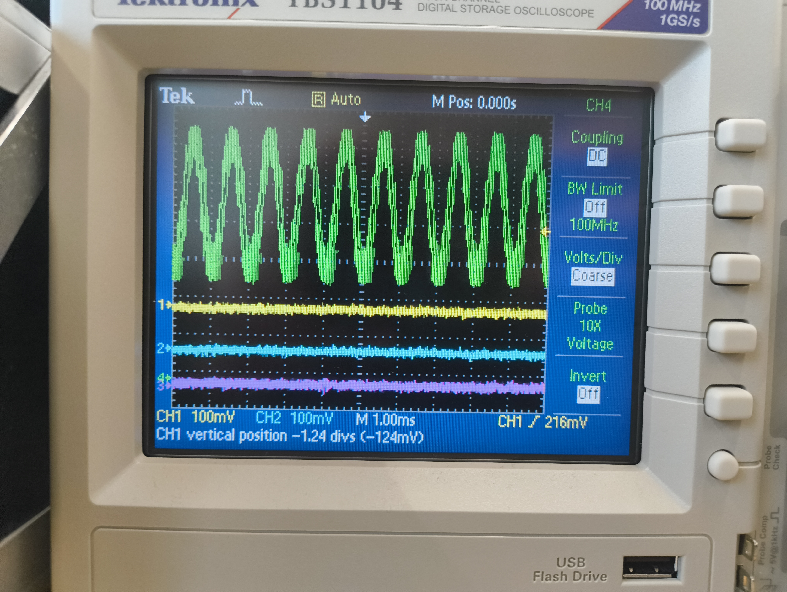
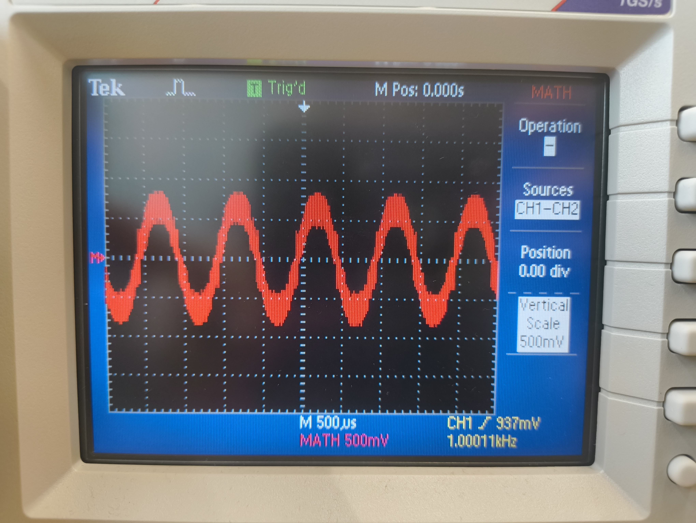
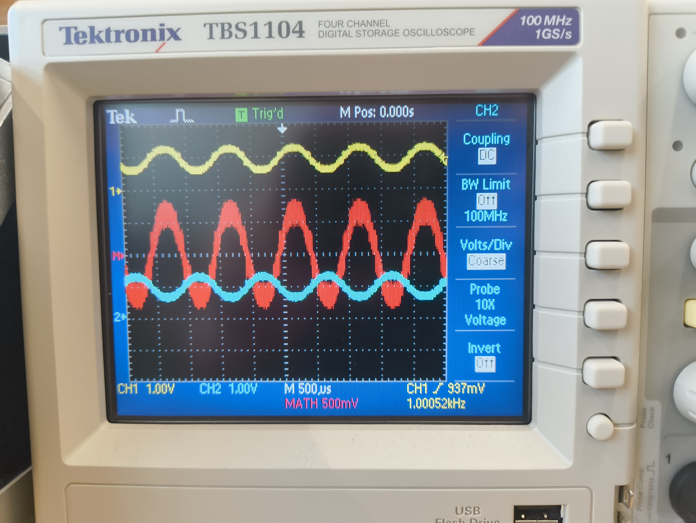
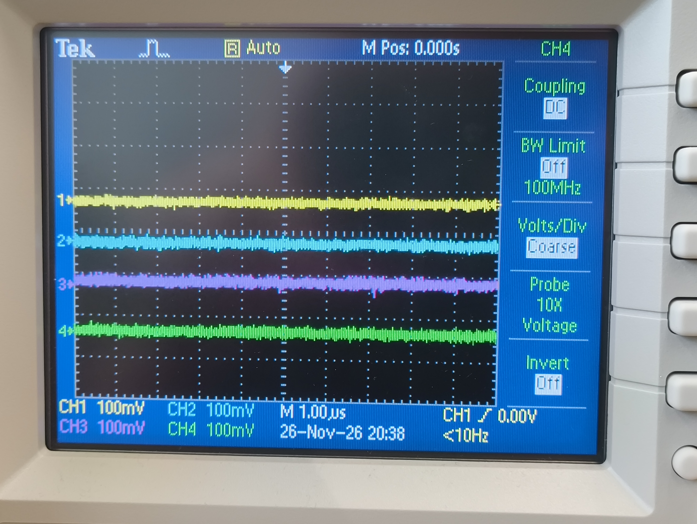

# Report to EBYTE — EWM104-BT5125(I2S) outputs analog audio, no I2S

**Subject:** EWM104-BT5125 "Version: I" (I2S) — audio appears on analog SPK pins, I2S pins inactive. Wrong firmware?

---

Dear EBYTE support,

following up on our previous conversation: we have now measured the module with an oscilloscope.
The results show that the module labelled **"Version: I"** does **not** output audio on the I2S
interface. Instead, the audio appears on the analog differential outputs (SPK pins), which is the
behaviour of the **(DAC)** version.

## Module

- Marking: EWM104-BT5125 · **Version: I** · Manufacturer: EBYTE · **SN: S5203841S00017**
- Order number: `<ORDER NUMBER>`

## Test setup

- Custom carrier board: EWM104-BT5125 → I2S → TI PCM5102A (same DAC as on your EWT104-DA10 board)
- VBAT = 3.8 V from a lab power supply; VDD_PADS1 / VDD_PADS3_7 = 3.3 V
- Module powered on with SYS_CTRL, paired with an Android phone (A2DP "Media audio")
- Test signal: 1 kHz sine, 0 dBFS, phone volume at maximum
- Oscilloscope: Tektronix TBS1104, probes ×10, ground at board GND

The module works normally: it boots, pairs, plays, and the LEDs follow play/pause.

## Key evidence — one capture, same moment

**CH4 (green): pin 37 (SPK-LP), 1 kHz sine. CH1: pin 3 (I2S_SDATA), CH2: pin 4 (I2S_LRCK), CH3: pin 5 (I2S_SCK) — all flat.**
Captured simultaneously during A2DP playback (1 ms/div).

## Measurement 1 — analog SPK outputs (pins 37 / 36)

Clean **1.000 kHz sine** on SPK-LP (37) and SPK-LN (36):
about 1.5 Vpp differential (CH1−CH2), about 0.7 Vpp on each pin.

## Measurement 2 — I2S pins (3, 4, 5, 6) during the same playback

All four pins are flat, at 100 mV/div and 1 µs/div with Auto trigger: **no clocks, no data.**

| Pin | Function | Result |
|---|---|---|
| 3 | I2S_SDATA | flat, ~0 V |
| 4 | I2S_LRCK | flat, ~0 V |
| 5 | I2S_SCK (bit clock) | flat, ~0 V |
| 6 | I2S_MCLK | flat, ~0 V |

With a 100 kΩ pull-up to 3.3 V, pin 4 (LRCK) rises to 3.0 V. The pin is a **high-impedance input**;
it is not driven by the module.

## Conclusion

During A2DP playback, the module outputs audio on the analog SPK outputs and leaves the I2S pins
inactive (high impedance). Your EWT104-DA10 manual states that the (I2S) version plays out of the
box through the PCM5102A at I2S_OUT, which requires the module to be **I2S master**. Our module
does not do this. We believe it carries the **(DAC) firmware** although it is labelled **Version: I**.

## Requests

1. Please check the firmware loaded on modules from this batch (SN S5203841S00017).
2. Please send replacement modules with verified **I2S master** firmware, **or** provide the
   correct (I2S) factory firmware image.
3. Two further modules from the same order stopped booting after being connected over USB to the
   Qualcomm configuration tools: the 1.8 V rail comes up, but no LEDs, no USB enumeration and no
   Bluetooth. We can program the on-module SPI flash (Macronix MX25U3232F) directly. Can you
   provide the factory (I2S) flash image so that we can restore them?
4. Please confirm the I2S parameters of the (I2S) firmware: master/slave, sample rate, word length,
   format (I2S / left-justified), and whether MCLK is output.

Thank you. We can provide further measurements if needed.

Best regards,
`<NAME>`
